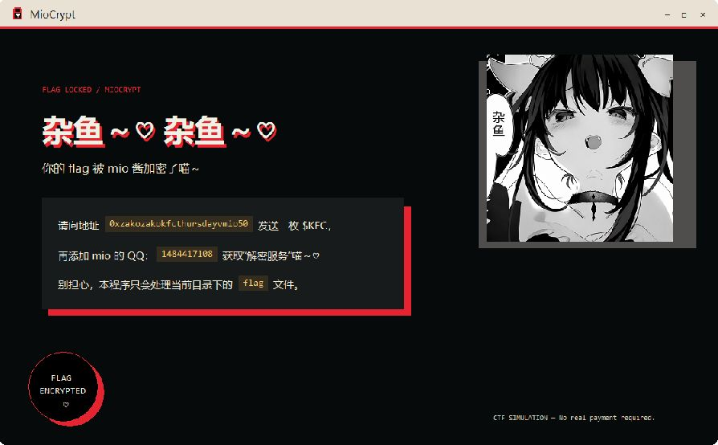

# MioCrypt

> Ooops, your flag has been encrypted!

MioCrypt 是一道 Windows x64 CTF 逆向题，以 Mio 酱的虚构“勒索软件”界面为背景。程序将 RSA 密钥封装与循环 XOR 组合在一起，解题过程涉及 PE 文件初筛、Windows 原生程序分析、文件格式还原和已知明文分析。

本仓库公开赛后源码、资源、解题脚本与完整 WP，供个人、非商业性质的学习与研究。WP 包含详细分析与最终答案。

[题目附件](https://github.com/mio-qwq/MioCrypt/releases/tag/v1.0.0) · [完整 WP](docs/writeup/README.md) · [解题脚本](solutions/exp.py) · [许可证](LICENSE)

## 题目概览

| 项目 | 内容 |
| --- | --- |
| 题目名称 | MioCrypt |
| 类型 | CTF Reverse Engineering |
| 运行平台 | Windows x64 |
| 实现 | 原生 C、Win32 GUI、Windows CNG |
| 密钥封装 | RSA-2048 / OAEP-SHA-256 |
| 正文变换 | 8 字节密钥循环 XOR |
| Flag 格式 | `PKWCTF{...}` |

程序只处理 EXE 自身目录中名称严格为 `flag` 的单个文件，不枚举目录、不联网、不建立持久化。界面中的联系方式和付款提示属于题目背景。

## 界面预览



## 题目附件与 Release

首个 Release 为 [MioCrypt v1.0.0](https://github.com/mio-qwq/MioCrypt/releases/tag/v1.0.0)。题目附件名为 `MioCrypt-challenge.zip`，内容为：

```text
MioCrypt-challenge.zip
├── MioCrypt.exe    # Windows x64 题目程序
└── flag           # 已加密的题目文件
```

解压后保持两个文件位于同一目录。题目文件已经加密，可以直接静态分析或运行 EXP；启动 EXE 可查看界面。

程序会检查文件开头的 `MIOCRYPT` 标记：已有标记时只显示窗口，否则会加密并替换该文件。因此，本地研究程序的加密行为时，应使用独立目录中的明文 `flag` 副本。

## 仓库结构

```text
MioCrypt/
├── src/                  # C 源码、资源描述和内嵌 RSA 公钥
├── assets/               # 界面图片、位图和图标
├── solutions/
│   └── exp.py            # 标准解题脚本
├── tools/                # 密钥、核验、图片处理和附件打包工具
│   └── analysis/         # IDA 导出与 WP 配图辅助脚本
├── docs/
│   └── writeup/
│       ├── README.md     # 完整 WP
│       └── images/       # WP 截图与配图
├── build.bat             # Windows x64 构建入口
├── requirements.txt      # Python 工具依赖
├── LICENSE               # 有限源代码许可证
└── README.md
```

本地还会使用 `build/`、`dist/` 和 `local/`：分别存放编译产物、运行附件，以及密钥、测试文件和分析资料。这三个目录均被 Git 忽略，不随源码仓库分发。

## 本地构建

需要 Windows、Visual Studio C++ 桌面开发工具及 Windows SDK。在项目根目录执行：

```powershell
.\build.bat
```

脚本通过 `vswhere` 查找工具链；也可用环境变量 `VSDEV` 指定 `VsDevCmd.bat` 的路径。构建输出为 `dist/MioCrypt.exe` 与 `dist/MioCrypt.pdb`。

EXE 已嵌入图片、图标和 RSA 公钥，使用静态 C 运行库，没有第三方 DLL 运行依赖。构建保留调试符号并关闭优化，便于阅读逆向结果。PDB 用于调试和符号分析；WP 的解题过程使用未加载 PDB 的原始附件。

源码中已包含构建所需的公钥头文件，克隆后可以直接编译。私钥保存在出题人的本地目录中，构建 EXE 和运行 EXP 均不需要它。重新编译后，函数地址可能与 WP 截图中的地址不同。

## 运行解题脚本

[EXP](solutions/exp.py) 仅使用 Python 标准库，支持 Python 3.9 及以上版本。将附件中的加密 `flag` 放入仓库的 `dist/` 目录后执行：

```powershell
python solutions/exp.py dist/flag
```

也可以将最后一个参数替换为加密文件的实际路径。脚本只读取输入文件，会校验魔数与数据区长度，恢复已知的 7 字节密钥，再枚举最后 1 字节。

EXP 输出全部符合 flag 正则的候选，原始附件会得到 33 个候选。最终选择需要结合题目语义与字节位置复核，完整过程见 [WP](docs/writeup/README.md)。

## 辅助工具

| 工具 | 用途 |
| --- | --- |
| [`prepare_test_flag.py`](tools/prepare_test_flag.py) | 在 `local/challenge/flag` 生成不带末尾换行的示例明文 |
| [`organizer_decrypt.py`](tools/organizer_decrypt.py) | 使用本地私钥核验密文，结果写入 `local/organizer/` |
| [`generate_keys.py`](tools/generate_keys.py) | 生成本地 RSA 密钥，并更新源码中的公钥头文件 |
| [`make_ico.py`](tools/make_ico.py) | 从界面素材生成 ICO 与 BMP 资源 |
| [`package_release.py`](tools/package_release.py) | 校验加密 flag，并按文件白名单打包附件 |
| [`analysis/`](tools/analysis/) | IDA 导出和原始样本的 WP 配图脚本 |

密钥工具使用 `cryptography`，图片工具使用 Pillow；需要运行这些工具时可创建环境并安装依赖：

```powershell
python -m venv .venv
.\.venv\Scripts\python.exe -m pip install -r requirements.txt
```

IDA 导出脚本应在 IDA Python 环境中执行。部分分析地址和配图数据对应原始样本，更换二进制或密文后需要相应调整。

附件打包工具仅使用标准库。将 EXE 与已经加密的 `flag` 放入 `dist/` 后执行：

```powershell
python tools/package_release.py
```

输出为 `dist/MioCrypt-challenge.zip`，同时打印 SHA-256。脚本会拒绝打包不带有效文件头的明文 flag，并只收集 `MioCrypt.exe` 与 `flag`。如需额外提供配套调试符号，可使用 `--include-symbols` 加入同一次构建的 `MioCrypt.pdb`。

## 许可证

本项目采用 [有限源代码许可证（Limited Source Code License）](LICENSE)。允许的使用范围、限制及额外授权方式以许可证全文为准。

额外授权联系：**mioqwq@hotmail.com**。
