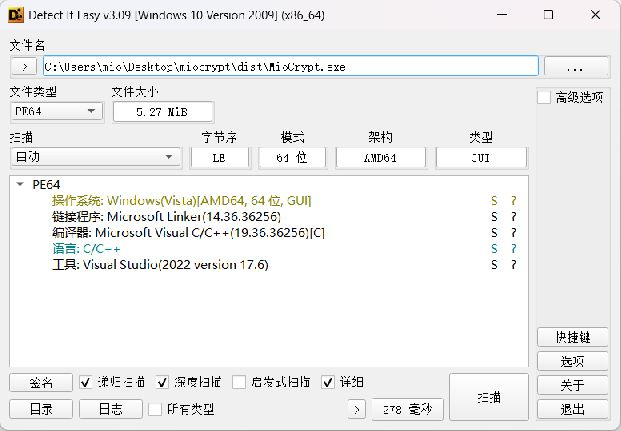
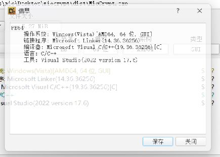
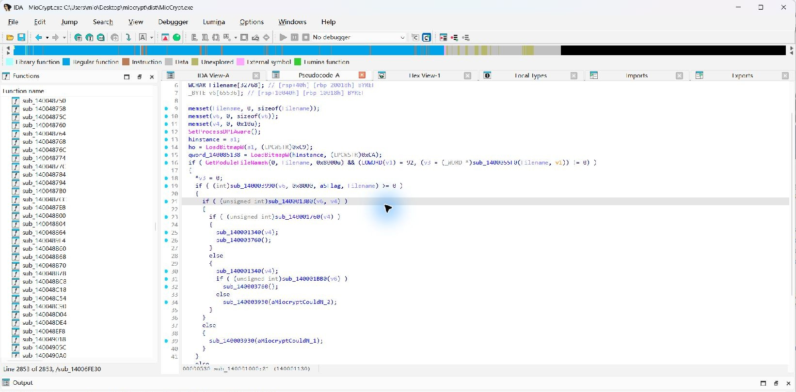
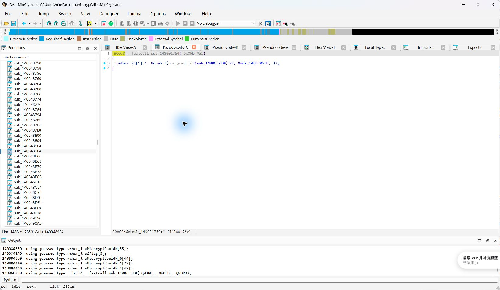
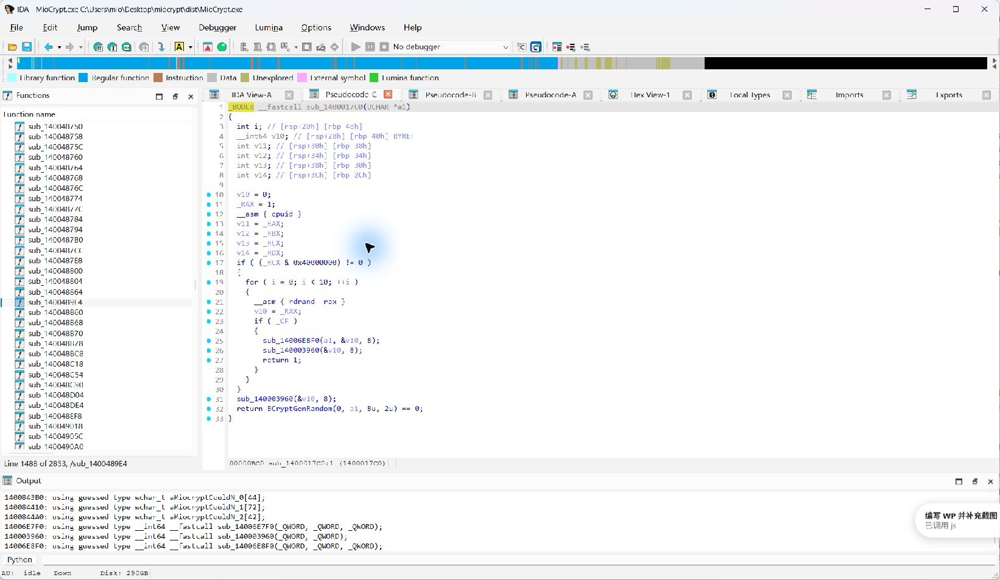
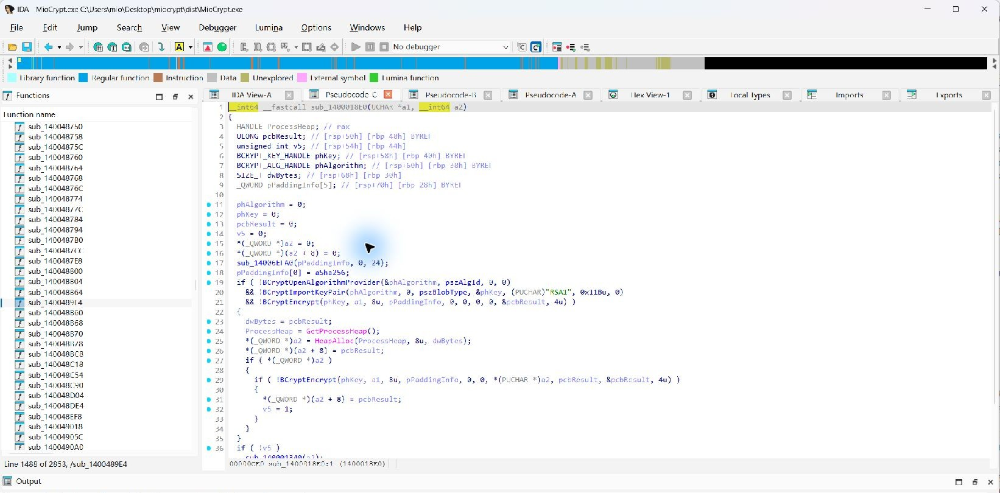
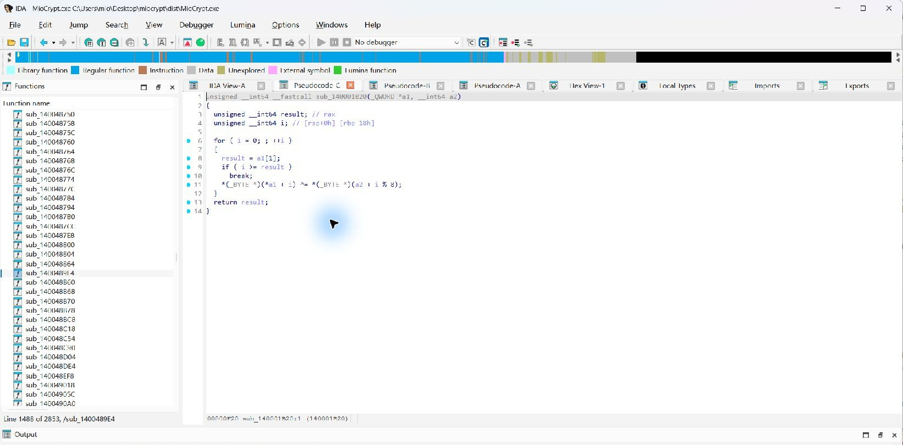

## MioCrypt 题解（Write-up）

> 本文从样本初筛开始，依次说明文件行为、加密格式、IDA Pro 伪代码分析和 flag 恢复。分析使用 MoeCTF.RE.Tools 工具包中的 IDA Pro 9.2；加载样本时拒绝 PDB，所有函数均以 IDA 自动生成的 `sub_...` 地址名表示。本文末尾附有完整 EXP 源码和运行说明，可单独阅读和发布。

### 0. 结论先行

加密文件格式为：8 字节 `MIOCRYPT` 魔数、256 字节 RSA-2048 密钥密文、其余部分为循环 XOR 正文。RSA 保护了 8 字节会话密钥，但正文加密只使用重复密钥 XOR。固定 flag 前缀 `PKWCTF{` 直接泄露密钥前 7 字节；枚举最后 1 字节的 256 种可能后，结合题目主题确定答案：

```text
PKWCTF{z4ko_z4ko_p4y_MioCh4n_1_KFC}
```

### 1. 样本信息与初步识别：DIE

选手附件包含 Windows x64 程序 `MioCrypt.exe` 和同目录的加密文件 `flag`。本解法只使用这两个文件，不依赖调试符号、PDB 或私钥。

先用工具包中的 Detect It Easy（DIE）识别样本，再进入反汇编分析：

```text
MoeCTF.RE.Tools 工具包中的 `die\die.exe`
```

在 DIE 中打开选手附件里的 `MioCrypt.exe` 并执行扫描。结果显示目标是 Windows PE64、AMD64 GUI 程序，使用 Microsoft Visual C/C++ 19.36.36256 编译、Microsoft Linker 14.36.36256 链接，对应 Visual Studio 2022 工具链。这给出了后续分析的基本环境信息：64 位 Windows GUI 程序，可按 Windows x64 调用约定阅读反汇编。



DIE 的详细信息页也确认编译器版本。初筛只帮助判断文件类型与编译环境，不足以说明文件一定有壳或没有壳；后续通过代码结构继续确认。



题目程序只处理自身目录里的 `flag`。附件中的 `flag` 已是加密文件，文件开头为 `MIOCRYPT`，所以不需要启动目标程序来“生成”样本；直接静态分析附件即可。程序界面不是解题入口，界面中的倒计时、联系方式等均是题目背景，不需交互。


### 2. 程序入口与文件处理逻辑（无符号表）

完成 DIE 初筛后，启动 MoeCTF.RE.Tools 工具包 `ida` 目录中的 IDA Pro：

```text
MoeCTF.RE.Tools 工具包中的 `ida\ida.exe`
```

通过 IDA 的文件打开对话框加载附件中的 `MioCrypt.exe`，使用默认 PE64 自动分析选项。加载过程中 IDA 根据 PE 中的调试目录提示找到了一个 PDB 路径；这里选择 **No**，不加载 PDB。分析完成后函数列表保留 `sub_140001000`、`sub_140001760` 等默认地址名，没有依赖函数名、局部变量名或类型符号。检查程序入口时选中函数列表中的入口，再按 **F5** 生成 Hex-Rays 伪代码。

下面截图由 Computer Use 从工具包内这份 IDA Pro 9.2 窗口直接截取。可以看到 F5 伪代码使用的是 `sub_...` 地址名；入口函数先取得 EXE 路径，再构造同目录 `flag` 路径、读取文件并检查数据。截图不包含 PDB 符号化后的函数名。



入口函数地址是 `0x140001000`。F5 结果中的 `GetModuleFileNameW` 表明程序从当前 EXE 取得路径；随后用路径分隔符截出目录，并将字符串格式 `"%s\\flag"` 与该目录组合。读取成功后，程序调用 `sub_1400013B0` 解析文件内容，再调用 `sub_140001760` 判断头部是否为已加密标记。控制流可整理为：

```text
取当前 EXE 所在目录
        │
拼接同目录的 flag 文件路径
        │
读取文件并解析数据结构
        │
检查是否已有 MIOCRYPT 魔数
   ┌────┴────┐
  已加密     未加密
  跳过加密   调用加密流程
```

这个入口分析既说明了程序输入是什么，也解释了为什么附件中的 `flag` 可以直接作为密文分析：它与 EXE 同目录，且已带加密标记。表格中的语义标签只是我们为了讲解方便对职责的概括；IDA 数据库里并没有把 `sub_...` 重命名。

| 地址（本样本） | 本文中的职责描述 | 追踪理由 |
| --- | --- | --- |
| `0x140001000` | GUI 入口及文件处理分支 | 找到输入路径、读取和分支逻辑 |
| `0x1400013B0` | 解析加密文件头 | 入口读取之后调用 |
| `0x140001760` | 检查 `MIOCRYPT` 标记 | 决定是否重复加密 |
| `0x1400017C0` | 生成 8 字节会话密钥 | 加密流程需要密钥 |
| `0x1400018E0` | RSA 公钥包装会话密钥 | 写入固定长度密钥块 |
| `0x140001B20` | 对正文执行循环 XOR | 数据实际变换位置 |
| `0x140001BB0` | 组织并替换加密文件 | 汇合密钥包装和正文加密 |

### 3. 解析加密文件格式

本题样本中的加密文件 `flag` 长度为 299 字节，开头 8 字节为：

```text
4d 49 4f 43 52 59 50 54
 M  I  O  C  R  Y  P  T
```

这与入口分支所检查的 `MIOCRYPT` 标记相符。对 `sub_140001760` 按 F5 后，可以直接读出它先要求数据长度至少为 8，再将数据开头 8 字节与程序内的常量比较；反编译器没有符号时显示为 `unk_...`，这也是无 PDB 分析的正常结果。



再对照加密函数的拼接顺序：程序先写 8 字节魔数，然后写 RSA 加密后的密钥，最后写变换后的正文。公钥为 RSA-2048，因此密钥密文固定 256 字节。由此得到布局：

| 文件偏移 | 长度 | 内容 |
| --- | ---: | --- |
| `0x000` | 8 字节 | ASCII `MIOCRYPT` |
| `0x008` | 256 字节 | RSA-2048 / OAEP-SHA-256 密钥密文 |
| `0x108` | 35 字节 | XOR 正文 |

正文偏移从 `8 + 256 = 264 = 0x108` 开始；总长 `8 + 256 + 35 = 299` 字节，也与文件大小吻合。因此解题时应只截取 `[0x108, EOF)`，不要将文件魔数或 RSA 块纳入 XOR。


### 4. 加密流程分析：RSA 封装与循环 XOR

入口进入未加密分支后，程序调用负责加密写回的函数。继续沿内部调用查看，会发现它分别准备会话密钥、用公钥封装密钥、变换正文并组合输出。密钥生成子程序 `sub_1400017C0` 先通过 `CPUID` 检查硬件能力；可用时最多尝试 10 次 `RDRAND`，取得 8 字节后返回。若硬件随机数不可用或尝试失败，则调用 `BCryptGenRandom` 请求 8 字节随机数。



之后 `sub_1400018E0` 打开 BCrypt 算法提供程序、导入 EXE 内置的 RSA 公钥 blob，并以 SHA-256 填充参数调用 `BCryptEncrypt` 包装这 8 字节。结果固定为 RSA-2048 的 256 字节。私钥并未嵌入 EXE，所以直接解 RSA 密文并非必要路线。



继续在无 PDB 的 IDA Pro 中按地址跳转并按 F5，可看到实际 XOR 伪代码。循环每处理一个正文字节，就取密钥第 `i % 8` 项与该字节异或；函数列表仍使用 `sub_...` 地址名。



可将它记为：

```text
C[i] = P[i] XOR K[i mod 8]
```

其中 `P` 为明文、`C` 为正文密文、`K` 为 8 字节会话密钥。虽然文件头用 RSA 包装会话密钥，但正文仍以同一 8 字节密钥循环 XOR。已知明文能够逐字节反推出对应密钥字节，这是本题真正的突破点。

注意，入口截图和分析中函数名仍然是 `sub_...`。上面“密钥生成”“RSA 包装”“正文 XOR”等描述只表示根据调用关系和伪代码归纳出来的功能，不代表 IDA 已经从 PDB 中获取这些名称。

### 5. 基于已知明文恢复密钥

题目 flag 格式固定为 `PKWCTF{...}`，所以正文开头 7 字节已知：

```text
P[0..6] = 50 4b 57 43 54 46 7b
```

XOR 可逆，变形后有：

```text
K[i mod 8] = C[i] XOR P[i]
```

本题样本的正文前 7 字节为 `5a f2 da af 62 8f ae`，逐字节异或：

| 正文下标 `i` | 明文字节 `P[i]` | 密文字节 `C[i]` | `P[i] XOR C[i]` |
| ---: | :---: | :---: | :---: |
| 0 | `0x50` (`P`) | `0x5a` | `0x0a` |
| 1 | `0x4b` (`K`) | `0xf2` | `0xb9` |
| 2 | `0x57` (`W`) | `0xda` | `0x8d` |
| 3 | `0x43` (`C`) | `0xaf` | `0xec` |
| 4 | `0x54` (`T`) | `0x62` | `0x36` |
| 5 | `0x46` (`F`) | `0x8f` | `0xc9` |
| 6 | `0x7b` (`{`) | `0xae` | `0xd5` |

所以密钥前 7 字节确定为：

```text
K[0..6] = 0a b9 8d ec 36 c9 d5
```

已知前缀还没有覆盖 `K[7]`。它是最后一个未知字节，只需枚举 `0x00` 到 `0xff`。


### 6. 穷举最后一字节并筛选格式

对每个候选 `K[7]`，使用完整的 8 字节循环密钥解密 35 字节正文，并检查常见格式：

```regex
^PKWCTF\{[A-Za-z0-9_]+\}$
```

完整 EXP 源码见附录 A。核心逻辑如下：

```python
payload = encrypted_file[8 + 256:]
known_key = bytes(payload[i] ^ b"PKWCTF{"[i] for i in range(7))

for last_byte in range(256):
    key = known_key + bytes([last_byte])
    plaintext = bytes(c ^ key[i % 8] for i, c in enumerate(payload))
    if re.fullmatch(rb"PKWCTF\{[A-Za-z0-9_]+\}", plaintext):
        print(plaintext.decode("ascii"))
```

这里不是去暴力破解 RSA，而是先用已知明文恢复 7 个字节，仅穷举最后 1 字节。对当前密文，格式正则留下 33 个候选；这是预期结果，因为正则能验证字符集和括号结构，却不能判断语义。

| 序号 | 正则通过的候选 |
| ---: | --- |
| 01 | `PKWCTF{b4ko_z4kw_p4y_MiwCh4n_1_SFC}` |
| 02 | `PKWCTF{c4ko_z4kv_p4y_MivCh4n_1_RFC}` |
| 03 | `PKWCTF{a4ko_z4kt_p4y_MitCh4n_1_PFC}` |
| 04 | `PKWCTF{f4ko_z4ks_p4y_MisCh4n_1_WFC}` |
| 05 | `PKWCTF{g4ko_z4kr_p4y_MirCh4n_1_VFC}` |
| 06 | `PKWCTF{d4ko_z4kq_p4y_MiqCh4n_1_UFC}` |
| 07 | `PKWCTF{e4ko_z4kp_p4y_MipCh4n_1_TFC}` |
| 08 | `PKWCTF{r4ko_z4kg_p4y_MigCh4n_1_CFC}` |
| 09 | `PKWCTF{s4ko_z4kf_p4y_MifCh4n_1_BFC}` |
| 10 | `PKWCTF{p4ko_z4ke_p4y_MieCh4n_1_AFC}` |
| 11 | `PKWCTF{v4ko_z4kc_p4y_MicCh4n_1_GFC}` |
| 12 | `PKWCTF{w4ko_z4kb_p4y_MibCh4n_1_FFC}` |
| 13 | `PKWCTF{t4ko_z4ka_p4y_MiaCh4n_1_EFC}` |
| 14 | `PKWCTF{z4ko_z4ko_p4y_MioCh4n_1_KFC}` |
| 15 | `PKWCTF{x4ko_z4km_p4y_MimCh4n_1_IFC}` |
| 16 | `PKWCTF{y4ko_z4kl_p4y_MilCh4n_1_HFC}` |
| 17 | `PKWCTF{B4ko_z4kW_p4y_MiWCh4n_1_sFC}` |
| 18 | `PKWCTF{C4ko_z4kV_p4y_MiVCh4n_1_rFC}` |
| 19 | `PKWCTF{A4ko_z4kT_p4y_MiTCh4n_1_pFC}` |
| 20 | `PKWCTF{F4ko_z4kS_p4y_MiSCh4n_1_wFC}` |
| 21 | `PKWCTF{G4ko_z4kR_p4y_MiRCh4n_1_vFC}` |
| 22 | `PKWCTF{D4ko_z4kQ_p4y_MiQCh4n_1_uFC}` |
| 23 | `PKWCTF{E4ko_z4kP_p4y_MiPCh4n_1_tFC}` |
| 24 | `PKWCTF{R4ko_z4kG_p4y_MiGCh4n_1_cFC}` |
| 25 | `PKWCTF{S4ko_z4kF_p4y_MiFCh4n_1_bFC}` |
| 26 | `PKWCTF{P4ko_z4kE_p4y_MiECh4n_1_aFC}` |
| 27 | `PKWCTF{V4ko_z4kC_p4y_MiCCh4n_1_gFC}` |
| 28 | `PKWCTF{W4ko_z4kB_p4y_MiBCh4n_1_fFC}` |
| 29 | `PKWCTF{T4ko_z4kA_p4y_MiACh4n_1_eFC}` |
| 30 | `PKWCTF{Z4ko_z4kO_p4y_MiOCh4n_1_kFC}` |
| 31 | `PKWCTF{X4ko_z4kM_p4y_MiMCh4n_1_iFC}` |
| 32 | `PKWCTF{Y4ko_z4kL_p4y_MiLCh4n_1_hFC}` |
| 33 | `PKWCTF{_4ko_z4kJ_p4y_MiJCh4n_1_nFC}` |

### 7. 结合题目线索并交叉验证

33 个候选大都呈现相同结构，四个受最后一个密钥字节影响的字符位于正文下标 7、15、23、31。它们对 8 取模均为 7，因此这四处反推出的都是同一个 `K[7]`。

结合题目“杂鱼”主题和 Mio 角色设定，第 14 个候选 `PKWCTF{z4ko_z4ko_p4y_MioCh4n_1_KFC}` 最符合题目上下文：`zako` 对应“杂鱼”梗，`MioCh4n` 和 `KFC` 也与题目主题相符。再由样本密文字节校验最后一个密钥字节：

```text
C[7]  XOR 'z' = 0x62 XOR 0x7a = 0x18
C[15] XOR 'o' = 0x77 XOR 0x6f = 0x18
C[23] XOR 'o' = 0x77 XOR 0x6f = 0x18
C[31] XOR 'K' = 0x53 XOR 0x4b = 0x18
```

四处结果一致，故当前样本的完整密钥为 `0a b9 8d ec 36 c9 d5 18`。使用该密钥异或整个正文即可得到最终 flag：

```text
PKWCTF{z4ko_z4ko_p4y_MioCh4n_1_KFC}
```

### 8. 解题思路总结

完整分析顺序如下：

1. 使用 MoeCTF.RE.Tools 中的 DIE 识别 PE 架构和编译工具链；
2. 观察附件 `flag` 的长度和魔数，确认输入已加密；
3. 启动 MoeCTF.RE.Tools 工具包中的 IDA Pro 加载 EXE，并在提示时拒绝加载 PDB；
4. 从入口 F5 伪代码确认程序路径、文件读取和已有密文分支；
5. 沿调用关系跟进文件头解析、密钥封装和正文变换；
6. 从 `MIOCRYPT || RSA密钥块 || XOR正文` 划分文件；
7. 用 `PKWCTF{` 推导密钥前 7 字节，穷举最后 1 字节；
8. 对所有格式候选结合题目语义判断，并用多个同余位置验证 `K[7]`。

题目的关键在于分别检查密钥封装和正文加密：本题没有破解 RSA-OAEP，而是利用短密钥循环 XOR 与已知明文前缀恢复正文。解题不需要 PDB、符号表或私钥。

### 附录 A：完整 EXP 源码

以下为本题的完整解题脚本。脚本只使用 Python 标准库，会校验魔数和数据区长度、恢复已知密钥字节、枚举最后一个密钥字节，并打印所有满足格式正则的候选。

```python
#!/usr/bin/env python3
"""MioCrypt 爆破 EXP：恢复已知密钥字节，枚举最后一字节并打印所有正则候选。"""

from __future__ import annotations

import argparse
import re
from pathlib import Path


# ------------------------------ 文件格式常量 ------------------------------
#
# 加密文件为：
#     8 字节魔数 || 256 字节 RSA 密文 || 循环 XOR 密文
#
# RSA 段只是用来包装 XOR 会话密钥的烟雾弹；本 EXP 不尝试解析或攻击它，
# 而是直接跳过这 256 字节，从后面的 XOR 数据区开始处理。
MAGIC = b"MIOCRYPT"
RSA_CIPHERTEXT_SIZE = 256
XOR_PAYLOAD_OFFSET = len(MAGIC) + RSA_CIPHERTEXT_SIZE  # 8 + 256 = 264 = 0x108

# 题目名称给出的已知明文。它恰好只有 7 字节，而 XOR 密钥有 8 字节。
# 因此 K[0]..K[6] 可直接恢复，K[7] 只能枚举 0x00..0xFF。
KNOWN_PREFIX = b"PKWCTF{"
KEY_SIZE = 8

# 正则只约束 flag 外观，不负责判断语义。故它可能保留多个候选，这正是
# 本题希望选手观察并手动判断的部分。
FLAG_PATTERN = re.compile(rb"^PKWCTF\{[A-Za-z0-9_]+\}$")

def xor_with_repeating_key(ciphertext: bytes, key: bytes) -> bytes:
    """用循环 XOR 密钥解密或加密数据。

    XOR 是可逆的：C = P XOR K，因此 P = C XOR K。密钥只有 8 字节，
    第 i 个密文使用 key[i % 8]，所以同一密钥字节会影响每隔 8 字节的
    所有位置。
    """

    return bytes(
        encrypted_byte ^ key[index % len(key)]
        for index, encrypted_byte in enumerate(ciphertext)
    )


def read_xor_payload(encrypted_path: Path) -> bytes:
    """读取并校验加密文件，返回位于偏移 0x108 的 XOR 数据区。"""

    encrypted_file = encrypted_path.read_bytes()

    if not encrypted_file.startswith(MAGIC):
        raise ValueError(
            "文件前 8 字节不是 MIOCRYPT；请确认传入的是已加密的 flag。"
        )
    if len(encrypted_file) <= XOR_PAYLOAD_OFFSET:
        raise ValueError("文件没有 XOR 数据区，无法继续。")

    return encrypted_file[XOR_PAYLOAD_OFFSET:]


def recover_first_seven_key_bytes(ciphertext: bytes) -> bytes:
    """使用已知明文 PKWCTF{ 恢复 K[0] 至 K[6]。

    对每个已知位置 i：
        C[i] = P[i] XOR K[i]
        K[i] = C[i] XOR P[i]

    KNOWN_PREFIX 长度为 7，故这里不会触及仍未知的 K[7]。
    """

    if len(ciphertext) < len(KNOWN_PREFIX):
        raise ValueError("XOR 数据区短于已知 flag 前缀。")

    return bytes(
        ciphertext[index] ^ KNOWN_PREFIX[index]
        for index in range(len(KNOWN_PREFIX))
    )


def brute_force_last_key_byte(ciphertext: bytes, known_key_bytes: bytes) -> list[tuple[bytes, bytes]]:
    """枚举 K[7] 的 256 种取值，返回所有匹配 flag 正则的 (key, plaintext)。

    注意：此函数故意只以正则筛选，不在此处加入任何语义关键词。
    这样调用方可以完整看到所有通过格式检查的候选，避免“EXP 偷偷替人
    做语义判断”。
    """

    if len(known_key_bytes) != KEY_SIZE - 1:
        raise ValueError("已恢复的密钥前缀长度应为 7 字节。")

    candidates: list[tuple[bytes, bytes]] = []
    for last_key_byte in range(256):
        # 拼出 K[0]..K[7]。这是唯一需要暴力枚举的未知量。
        key = known_key_bytes + bytes([last_key_byte])
        plaintext = xor_with_repeating_key(ciphertext, key)

        # fullmatch 同时确认固定前缀、右花括号以及内部字符集。
        if FLAG_PATTERN.fullmatch(plaintext):
            candidates.append((key, plaintext))

    return candidates


def show_all_candidates(candidates: list[tuple[bytes, bytes]]) -> None:
    """按枚举顺序打印全部正则候选。

    这里有意只输出候选 flag 本身。EXP 不负责根据可读性或题意替选手
    作判断；多个候选之间的人工推理应由选手自行完成。
    """

    print("=" * 72)
    print(f"符合正则 {FLAG_PATTERN.pattern.decode('ascii')} 的全部候选：{len(candidates)} 个")
    print("=" * 72)
    for number, (_, plaintext) in enumerate(candidates, start=1):
        print(f"[{number:02d}] {plaintext.decode('ascii')}")


def main() -> None:
    """解析命令行、恢复 7 字节密钥、枚举最后 1 字节并输出结果。"""

    parser = argparse.ArgumentParser(description=__doc__)
    parser.add_argument("encrypted_flag", type=Path, help="加密后的 flag 文件路径")
    args = parser.parse_args()

    ciphertext = read_xor_payload(args.encrypted_flag)
    known_key_bytes = recover_first_seven_key_bytes(ciphertext)
    candidates = brute_force_last_key_byte(ciphertext, known_key_bytes)

    if not candidates:
        raise SystemExit("没有候选通过 flag 正则；请检查文件、魔数或 flag 格式。")

    # 到此为止：EXP 只负责列出正则候选，不进行任何额外判断。
    show_all_candidates(candidates)


if __name__ == "__main__":
    main()
```

### 附录 B：运行方法与复现说明

1. 将附录 A 中的代码保存为 `exp.py`。
2. 将题目提供的加密文件命名为 `flag`，放在当前目录；也可以在命令中提供其他文件路径。
3. 在终端运行：

```powershell
python exp.py flag
```

也可从仓库根目录直接运行 `python solutions/exp.py dist/flag`。脚本适用于 Python 3.9 及以上版本，不需要安装第三方库。它只读取输入文件，不会修改或删除输入。若传入文件的前 8 字节不是 `MIOCRYPT`，脚本会提示文件格式不符；若没有候选通过正则，需检查样本格式或 flag 前缀是否与题目一致。

对本文分析的样本，脚本得到 33 个符合格式的候选。脚本不按题目主题挑答案；需人工判断后再用正文下标 7、15、23、31 的密钥关系交叉验证。第 14 项与题目主题相符，且四个位置都反推出 `K[7] = 0x18`。

### 附录 C：阅读与复现时的注意事项

- **PDB 不是运行依赖。** PDB 只可能提供更友好的函数和变量名称。本解法拒绝加载 PDB，分析流程和结论仍然成立。
- **不要把 RSA 块交给 XOR。** 文件前 264 字节由魔数和 RSA 密钥密文组成；XOR 正文从偏移 `0x108` 开始。
- **候选不是唯一性证明。** 正则只验证 flag 外形。最终选择要结合题目语义，并用同一密钥字节在相隔 8 字节的位置复核。
- **样本中的具体密钥只对应本次加密文件。** 若重新生成密文，前 7 个密钥字节及相应正文密文字节会变化；已知前缀推导和枚举方法保持不变。
- **IDA 地址与版本有关。** 文中地址用于定位本题所分析的构建。遇到不同构建时，应从入口和调用关系重新确认职责，不要仅凭地址判断。
